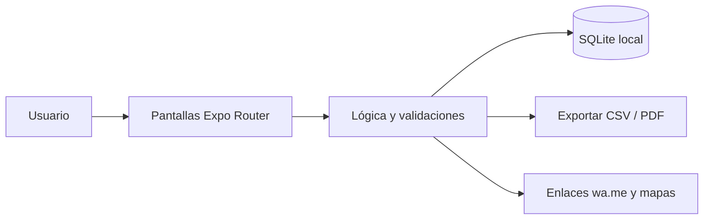

<div align="center">


# 🚛 FleteCuenta

**Control de viajes de carga: flete cobrado, gastos de ruta y utilidad por viaje y por camión.**

[](LICENSE)
[](https://github.com/LuisRocha2080/FleteCuenta/actions/workflows/ci.yml)


[Inicio rápido](#-inicio-rápido) · [Características](#-características) · [Arquitectura](#️-arquitectura) · [Roadmap](#️-roadmap) · [Pruebas](#-pruebas) · [Limitaciones](#-lo-que-todavía-no-existe) · [Contribuir](#-contribuir)

</div>

El dueño sabe cuánto cobró de flete pero no cuánto le quedó: combustible, peajes, viáticos y reparaciones se pierden en papeles sueltos y la utilidad real de cada viaje es un misterio. **FleteCuenta** es una app móvil (Android) hecha con React Native + Expo y SQLite local, pensada para dueños de uno a diez camiones, fleteros independientes y pequeñas transportadoras. Funciona sin internet, sin servidores y sin licencias de pago. **Todavía no es una app lista para usar:** hoy el repositorio contiene la especificación, el plan, el modelo de datos, el diseño de pantallas y la base de configuración; el código de la app llega por fases (ver [Roadmap](#️-roadmap) y [Lo que todavía no existe](#-lo-que-todavía-no-existe)).

## 🎬 Vista rápida

> Aún no hay capturas: la app no está implementada. Las pantallas planificadas están descritas en [docs/PANTALLAS.md](docs/PANTALLAS.md) y se agregarán capturas reales al cerrar la primera fase.

Flujo principal:

```
Viajes → Nuevo viaje → Gastos del viaje → Camiones y choferes → Cobros pendientes → Resumen mensual
```

| Pantalla | Qué muestra |
|---|---|
| Viajes | Lista por estado (programado, en ruta, entregado, cobrado). |
| Nuevo viaje | Camión, chofer, ruta, flete y anticipo entregado. |
| Gastos del viaje | Carga rápida de gastos con categoría y foto opcional del comprobante. |
| Camiones y choferes | Fichas con placa, capacidad y comisión. |
| Cobros pendientes | Saldos por cliente y vencimientos. |
| Resumen mensual | Ingresos, gastos y utilidad por camión con gráfico simple. |

## ✨ Características

| Característica | Detalle |
|---|---|
| Registro de viajes | Registro de viajes con origen, destino, fechas, kilometraje y flete pactado. |
| Gastos por viaje | Gastos por viaje: combustible, peajes, viáticos, balanza, reparaciones y otros. |
| Utilidad automática por | Utilidad automática por viaje, por camión y por mes. |
| Cobros pendientes por | Cobros pendientes por cliente con fecha de vencimiento. |
| Camiones y choferes | Camiones y choferes con comisión configurable por viaje. |
| Liquidación mensual por | Liquidación mensual por camión en PDF para compartir por WhatsApp. |

Todos los datos viven en el dispositivo (SQLite): sin cuentas, sin suscripciones y sin servicios de pago.

## 🏗️ Arquitectura



| Capa | Tecnología |
|---|---|
| App | React Native + Expo (TypeScript) |
| Datos | SQLite local (`expo-sqlite`) |
| Navegación | Expo Router |
| Pruebas | Jest + `tsc --noEmit` |
| Distribución | APK directo / EAS Build local |

**Modelo de datos**

| Tabla | Campos |
|---|---|
| `camiones` | id, placa, descripcion, capacidad_t, activo |
| `choferes` | id, nombre, telefono, comision_pct |
| `viajes` | id, camion_id, chofer_id, origen, destino, fecha_salida, fecha_llegada, km, flete, anticipo, estado |
| `gastos_viaje` | id, viaje_id, categoria, monto, fecha, nota, foto_uri |
| `cobros` | id, viaje_id, cliente, monto, vence_en, cobrado_en |

<details>
<summary>Estructura de carpetas</summary>

```
FleteCuenta/
├── app/                 # pantallas (Expo Router)
├── src/
│   ├── components/      # componentes de interfaz
│   ├── db/              # esquema y consultas SQLite
│   └── lib/             # lógica y validaciones
├── docs/                # especificación, roadmap, planificación, datos, pantallas, pruebas, backlog y negocio
├── .github/             # CI, CodeQL, Dependabot, plantillas de issues y PR
├── app.json · package.json · tsconfig.json
└── LICENSE · CHANGELOG.md · CONTRIBUTING.md · SECURITY.md · SUPPORT.md
```

</details>

## 🗺️ Roadmap

1. **Base y navegación:** Proyecto Expo + TypeScript, Esquema SQLite, Navegación por pestañas
2. **Camiones y choferes:** CRUD de flota, Comisión por chofer
3. **Viajes y gastos:** Alta de viaje, Gastos por categoría, Utilidad por viaje
4. **Cobros y resumen:** Cobros pendientes y vencidos, Resumen mensual por camión
5. **Liquidación y piloto:** PDF de liquidación, Exportación CSV, APK de prueba con 3 transportistas piloto

Detalle fase por fase en [docs/ROADMAP.md](docs/ROADMAP.md). Documentación completa: [SPEC](docs/SPEC.md) · [PLANNING](docs/PLANNING.md) · [DATOS](docs/DATOS.md) · [PANTALLAS](docs/PANTALLAS.md) · [PRUEBAS](docs/PRUEBAS.md) · [BACKLOG](docs/BACKLOG.md) · [NEGOCIO](docs/NEGOCIO.md).

## 💼 Modelo comercial

| Aspecto | Detalle |
|---|---|
| Cómo se vende | Pago único por flota pequeña o plan anual con soporte. |
| Precio de partida | Hipótesis a validar: Bs 250–400 pago único, o Bs 50 al mes. |
| Canal | Playas de camiones, asociaciones de transportistas y grupos de WhatsApp del rubro. |
| Piloto | 3 transportistas por 45 días, comparando la utilidad que estimaban con la calculada por la app. |

Los precios son hipótesis para validar con clientes reales, no resultados medidos.

## 🚀 Inicio rápido

| Requisito | Versión |
|---|---|
| Node.js | 18+ |
| npm | 9+ |
| Android | Expo Go o emulador |

Clona el repositorio y entra a la carpeta.

```bash
git clone https://github.com/LuisRocha2080/FleteCuenta.git
cd FleteCuenta
```

Cuando exista el código de la app (fase 1 del roadmap), se instalará y arrancará así:

```bash
npm install
npm start        # Expo; escanea el QR con Expo Go
npm run android  # o en el emulador
```

> **No verificado:** `package.json` todavía no declara dependencias, así que `npm install` y `npm start` aún no levantan una app. Los scripts `npm test` y `npm run typecheck` sí están definidos y pasan sin pruebas todavía.

<details>
<summary>Variables de entorno</summary>

FleteCuenta no usa variables de entorno ni claves de API: todo funciona en el dispositivo. `.env.example` queda como plantilla vacía por si se agrega una integración (declarala sin valores reales).

</details>

## 🧪 Pruebas

Casos que la suite debe cubrir (definidos en [docs/PRUEBAS.md](docs/PRUEBAS.md)):

- Cálculo de utilidad con comisión y anticipo.
- Liquidación de un mes sin viajes y de un mes con viajes entre dos meses.
- Guardado de fotos de comprobantes sin conexión.
- Desactivación de camión con historial.
- Rendimiento con 2 000 viajes de prueba.

Hoy `npm test` corre Jest sin pruebas (`--passWithNoTests`) y `npm run typecheck` ejecuta `tsc --noEmit`. El pipeline de CI y el análisis CodeQL corren en GitHub Actions en cada push y PR a `main`.

## 🔒 Seguridad

**Implementado:** no hay cuentas, contraseñas ni servidores; no se envían datos a terceros. El repositorio tiene activados el reporte privado de vulnerabilidades, Dependabot y la protección de secretos, y hay un workflow de CodeQL.

**Avisos importantes:**

- La base SQLite local no está cifrada: quien tenga acceso al dispositivo desbloqueado puede ver los datos.
- No hay copia de respaldo en la nube; si se pierde el teléfono se pierden los datos (la exportación a CSV/PDF está prevista en el diseño, ver [docs/SPEC.md](docs/SPEC.md)).
- Los problemas de seguridad se reportan según [SECURITY.md](SECURITY.md).

## 🚧 Lo que todavía no existe

- **La app en sí:** el repositorio es la base documental y de configuración; las pantallas, la base de datos y la lógica se construyen fase por fase (ver Roadmap).
- Sin seguimiento GPS del camión: no es un sistema de rastreo.
- Un solo dispositivo por flota en la primera versión.
- No emite carta de porte ni documentos aduaneros.
- Sin capturas de pantalla, sin pruebas automáticas reales y sin APK publicado.
- Los precios y el piloto del modelo comercial son hipótesis sin validar.

## 🤝 Contribuir

¡Las contribuciones son bienvenidas! Leé la [guía de contribución](CONTRIBUTING.md) y el [código de conducta](CODE_OF_CONDUCT.md) antes de abrir un PR. Para bugs o ideas usá las plantillas de issues; los problemas de seguridad se reportan según la [política de seguridad](SECURITY.md). ¿Dudas? Mirá [SUPPORT.md](SUPPORT.md). Los cambios por versión están en el [CHANGELOG](CHANGELOG.md).

## 📄 Licencia

Distribuido bajo la licencia MIT. Ver [LICENSE](LICENSE).

---

<div align="center">Hecho por <a href="https://github.com/LuisRocha2080">LuisRocha2080</a> · control de viajes de carga con React Native, Expo y SQLite</div>
