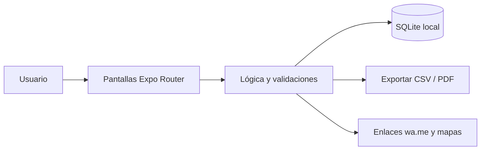

<div align="center">


# FleteCuenta

**Control de viajes de carga: flete cobrado, gastos de ruta y utilidad por viaje y por camión.**

[](LICENSE)
[](https://github.com/LuisRocha2080/FleteCuenta/actions/workflows/ci.yml)


[Vista rápida](#vista-rápida) · [Características](#características) · [Stack](#stack) · [Roadmap](#roadmap) · [Modelo comercial](#modelo-comercial) · [Inicio rápido](#inicio-rápido) · [Contribuir](#contribuir)

</div>

---

## Vista rápida

| | |
|---|---|
| **Para quién** | Dueños de uno a diez camiones, fleteros independientes y pequeñas transportadoras |
| **Problema** | El dueño sabe cuánto cobró de flete pero no cuánto le quedó: combustible, peajes, viáticos y reparaciones se pierden en papeles sueltos y la utilidad real de cada viaje es un misterio. |
| **Solución** | App móvil que funciona sin internet y guarda todo en el teléfono. |
| **Costo de licencias** | Bs 0: Expo, React Native, SQLite y TypeScript son de código abierto. |

## Características

- Registro de viajes con origen, destino, fechas, kilometraje y flete pactado.
- Gastos por viaje: combustible, peajes, viáticos, balanza, reparaciones y otros.
- Utilidad automática por viaje, por camión y por mes.
- Cobros pendientes por cliente con fecha de vencimiento.
- Camiones y choferes con comisión configurable por viaje.
- Liquidación mensual por camión en PDF para compartir por WhatsApp.

Sin servidores, sin suscripciones obligatorias y sin servicios de pago: todos los datos viven en el dispositivo (SQLite).

## Stack

| Capa | Tecnología |
|---|---|
| App | React Native + Expo (TypeScript) |
| Datos | SQLite local (`expo-sqlite`) |
| Navegación | Expo Router |
| Pruebas | Jest + `tsc --noEmit` |
| Distribución | APK directo / EAS Build local |

### Modelo de datos

- `camiones` (id, placa, descripcion, capacidad_t, activo)
- `choferes` (id, nombre, telefono, comision_pct)
- `viajes` (id, camion_id, chofer_id, origen, destino, fecha_salida, fecha_llegada, km, flete, anticipo, estado)
- `gastos_viaje` (id, viaje_id, categoria, monto, fecha, nota, foto_uri)
- `cobros` (id, viaje_id, cliente, monto, vence_en, cobrado_en)

Detalle completo: [docs/DATOS.md](docs/DATOS.md).

## Arquitectura



## Roadmap

1. Base y navegación
2. Camiones y choferes
3. Viajes y gastos
4. Cobros y resumen
5. Liquidación y piloto

Detalle fase por fase: [docs/ROADMAP.md](docs/ROADMAP.md) · [docs/SPEC.md](docs/SPEC.md) · [docs/PLANNING.md](docs/PLANNING.md) · [docs/DATOS.md](docs/DATOS.md) · [docs/PANTALLAS.md](docs/PANTALLAS.md) · [docs/PRUEBAS.md](docs/PRUEBAS.md) · [docs/BACKLOG.md](docs/BACKLOG.md) · [docs/NEGOCIO.md](docs/NEGOCIO.md)

## Modelo comercial

- **Cómo se vende:** Pago único por flota pequeña o plan anual con soporte.
- **Precio de partida:** Hipótesis a validar: Bs 250–400 pago único, o Bs 50 al mes.
- **Canal:** Playas de camiones, asociaciones de transportistas y grupos de WhatsApp del rubro.
- **Piloto:** 3 transportistas por 45 días, comparando la utilidad que estimaban con la calculada por la app.

Los precios son hipótesis para validar con clientes reales antes de fijarlos. Ver [docs/NEGOCIO.md](docs/NEGOCIO.md).

## Estructura

```
FleteCuenta/
├── app/            # Pantallas y rutas (Expo Router)
├── src/
│   ├── db/         # Esquema y consultas SQLite
│   ├── components/ # Componentes reutilizables
│   └── lib/        # Utilidades
├── docs/           # Roadmap, specs, planificación, datos, pantallas, pruebas, backlog
└── .github/        # Plantillas, CI y Dependabot
```

## Inicio rápido

Requisitos: Node.js 20+ y la app Expo Go (o un emulador).

```bash
git clone https://github.com/LuisRocha2080/FleteCuenta.git
cd FleteCuenta
npm install
npx expo start
```

> El repositorio está en **fase inicial**: la documentación y la estructura están listas y el código de la app se construye siguiendo el [roadmap](docs/ROADMAP.md).

## Pruebas

```bash
npm test
npx tsc --noEmit
```

## Seguridad

Los datos no salen del teléfono. Para reportar una vulnerabilidad lee [SECURITY.md](SECURITY.md).

## Lo que todavía no existe

- Sin seguimiento GPS del camión: no es un sistema de rastreo.
- Un solo dispositivo por flota en la primera versión.
- No emite carta de porte ni documentos aduaneros.

## Contribuir

Lee la [guía de contribución](CONTRIBUTING.md) y el [código de conducta](CODE_OF_CONDUCT.md). Para dudas, consulta [SUPPORT.md](SUPPORT.md).

## Licencia

Distribuido bajo licencia MIT. Consulta [LICENSE](LICENSE).

---

<div align="center">Hecho por <a href="https://github.com/LuisRocha2080">LuisRocha2080</a></div>
